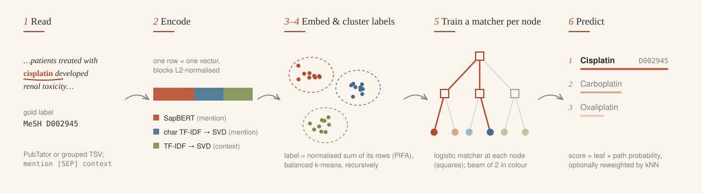
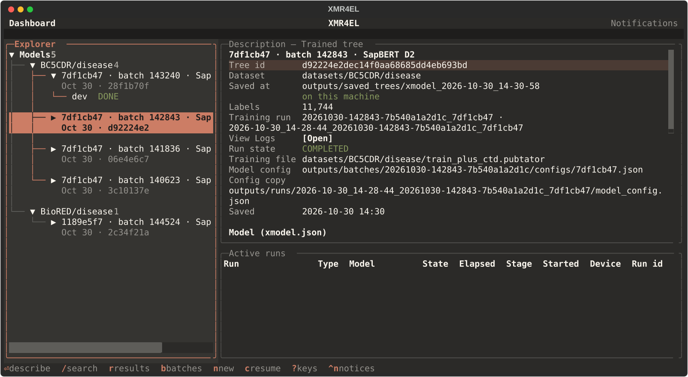
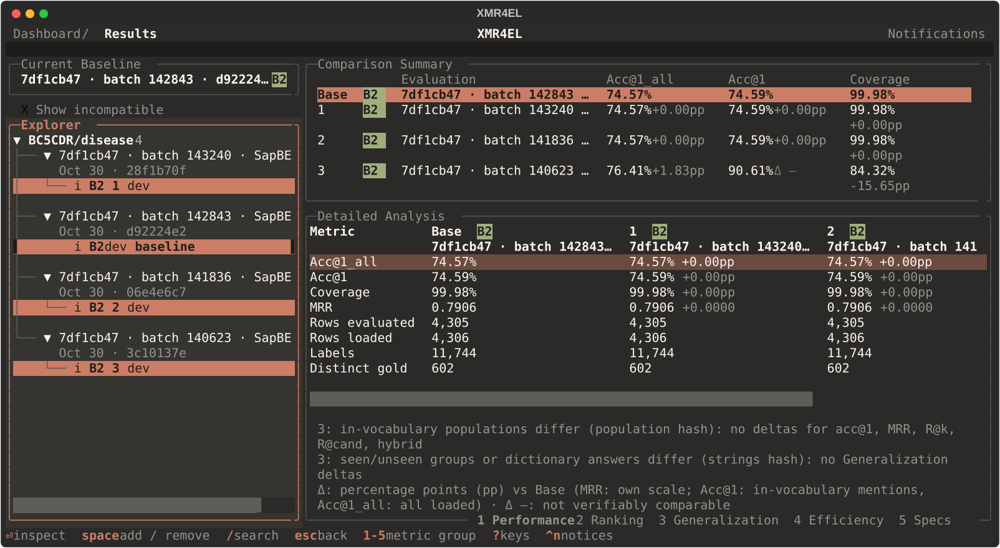

# XMR4EL

[](https://github.com/lasigeBioTM/XMR4EL/actions/workflows/ci.yml)

[](LICENSE)

Extreme multi-label ranking (XMR) for biomedical entity linking. Given a mention and its document context,
XMR4EL ranks concept IDs from a large label space (MeSH, OMIM, UMLS CUIs, ...). It clusters the labels into a
tree, trains a matcher per tree node, and searches the tree with a beam at prediction time.

XMR4EL links mentions you supply; it does not detect them. Training and evaluation run from scripts on local
files.

| Part | Contents |
|---|---|
| `xmr4el/` | Library: read data, encode, cluster, train the tree, predict, evaluate. |
| `scripts/` | `train.py`, `evaluate.py`, `run_experiment.py`, data conversion, diagnostics, 1-NN baselines ([guide](scripts/README.md)). |
| `xmr4el_tui/` | Optional terminal UI to browse, compare and launch runs. |
| `configs/` | Model configs and experiment specs (JSON). |
| `docs/` | [Pipeline behavior, future work, TUI design](docs/README.md). |

## How it works



1. **Read** PubTator annotations (or grouped TSV texts). Each annotation becomes `mention [SEP] context`
   with its concept ID as the label.
2. **Encode** each row. The default (`"sapbert_char_context"`) joins three L2-normalised blocks:
   SapBERT [CLS] of the mention, character TF-IDF -> SVD of the mention, and TF-IDF -> SVD of the context
   window.
3. **Embed labels** with PIFA: the normalised sum of each label's training rows.
4. **Cluster** the label embeddings into a tree with balanced k-means.
5. **Train** one-vs-rest L2 logistic matchers: per internal node over its child clusters, per leaf over its
   labels.
6. **Predict** by beam search from the root. Each visited leaf contributes its best labels, scored by leaf
   probability x routing-path probability, optionally reweighted by mention similarity to the label's
   training rows (`knn_beta`).

## Installation

Python 3.12+ and [uv](https://docs.astral.sh/uv/):

```bash
git clone https://github.com/lasigeBioTM/XMR4EL.git xmr4el && cd xmr4el
uv sync --locked                 # add --extra tui for the terminal UI
```

`uv.lock` pins every dependency. On Linux, torch comes from the PyTorch CUDA 12.6 index. Encoding and matcher
training use CUDA when available, then Apple MPS, otherwise CPU. The first transformer use downloads the
model from the Hugging Face Hub.

Commands below use `.venv/bin/python`; inside the Docker image use `python3`.

## Quick start

Train on a PubTator corpus, then evaluate the saved tree on a held-out split:

```bash
.venv/bin/python scripts/train.py \
  -train_path datasets/ncbi_disease/train.pubtator \
  -model_config configs/xmr4el_bc5cdr_config.json && \
.venv/bin/python scripts/evaluate.py \
  -xmodel_path outputs/saved_trees/<run> \
  -test_path datasets/ncbi_disease/dev.pubtator
```

Trees are saved to `outputs/saved_trees/xmodel_<timestamp>/`. `-ds_len N` trains on the first `N` labels only
(a fast smoke run).

From Python:

```python
from xmr4el.xmodel import XModel

model = XModel.load("outputs/saved_trees/<run>")
scores = model.predict(["aspirin [SEP] Aspirin reduced the risk of stroke."])
best = model.initial_labels[scores[0].toarray().argmax()]
```

`scores` is a sparse (queries x labels) matrix; column `j` is `model.initial_labels[j]` (sorted label IDs).
Search settings default to the tree's `predict_config`; the `beam_size`, `topk`, `knn_beta` and
`leaf_candidates` keyword arguments override them.

## Input formats

Datasets are not part of the repository; put them under `datasets/` or `data/`. Download and conversion
recipes for NCBI-disease, BC5CDR, BioRED, NLM-Chem, MedMentions and CTD dictionaries are in
[`scripts/README.md`](scripts/README.md).

### PubTator

```
12345|t|Aspirin and stroke
12345|a|Aspirin reduced the risk of stroke.
12345	0	7	Aspirin	Chemical	D001241
12345	12	18	stroke	Disease	D020521
```

Title and abstract lines, then one tab-separated annotation per line: document ID, start, end, mention, type,
concept ID. Offsets index `title + " " + abstract`. The context is the `context_window` words on each side of
the mention (10 in the provided configs).

- ID `-1` is skipped. A composite ID `D1|D2` becomes one example per ID, with texts from column 7; a composite
  without column 7 is skipped (BC5CDR conventions).
- An annotation without a concept ID is skipped with a warning. Relation lines are ignored.
- A mention that differs from the text at its offsets is kept, with a warning.
- Annotations outside their document, or offsets outside the text, stop the load with `file:line`.

### Grouped TSV

Rows are `group_id<TAB>text`; a separate file has one label ID per line, aligned with the sorted group IDs.
Plain text has no `[SEP]`, so it needs `"features": "tfidf"`:

```bash
.venv/bin/python -c "import json; c = json.load(open('configs/xmr4el_base_config.json')); c['features'] = 'tfidf'; json.dump(c, open('configs/local_tfidf_config.json', 'w'), indent=4)" && \
.venv/bin/python scripts/train.py \
  -train_path data/train/chemical/train_Chemical.txt \
  -labels_path data/train/chemical/labels.txt \
  -model_config configs/local_tfidf_config.json
```

The loader rejects too few labels and drops labels beyond the number of groups: check that the two files are
aligned.

## Evaluation

```bash
.venv/bin/python scripts/evaluate.py -xmodel_path outputs/saved_trees/<run> -test_path <file.pubtator>
```

Reports acc@1, MRR, recall@k, candidate recall (`R@cand`) and vocabulary coverage. Metrics are computed on
mentions whose gold label has training text; `acc@1_all` counts the others as misses. `-beam_size`, `-topk`,
`-knn_beta` and `-leaf_candidates` override the saved search settings; `-train_path` adds a seen/unseen
mention-string breakdown.

### Tracked experiments

```bash
.venv/bin/python scripts/run_experiment.py -spec configs/experiments/ncbi_disease.json
```

Trains and evaluates one spec and records the run under `outputs/runs/<timestamp>_<name>/`: spec, config, git
state, input hashes, package versions, log and `metrics_<split>.json`. `-xmodel_path <tree>` reuses a saved
tree (e.g. the `*_test.json` specs). An input file that changes during the run fails it.

## Configuration

`configs/xmr4el_base_config.json` (MedMentions) and `configs/xmr4el_bc5cdr_config.json` (BC5CDR, also used for
NCBI-disease, BioRED and NLM-Chem).

| Key | Meaning |
|---|---|
| `features` | `"sapbert_char_context"` (PubTator) or `"tfidf"` (plain text) |
| `transformer_config` | `type` `sapbert`, `sentencetbiobert` or `biobert`, or `kwargs.model_name` (HF ID or local directory); optional `pooling` (`cls` / `mean`), `max_seq_length`, `revision` |
| `abbrev_expansion` | `"append"` / `"replace"`: expand in-document abbreviations in mentions |
| `context_window` | words on each side of the mention used as context |
| `vectorizer_config`, `context_vectorizer_config` | TF-IDF of the mention / context |
| `dimension_config`, `context_dimension_config` | SVD of those blocks |
| `clustering_config` | `balancedkmeans`: `n_clusters` per node, `iter_limit`, `refine_iter`, `seed` |
| `depth`, `min_leaf_size` | fixed tree depth; clusters below `min_leaf_size` labels merge into the nearest larger one (small datasets: lower `depth`, `min_leaf_size` or `n_clusters`) |
| `matcher_config` | `jointlogisticregression`: `C`, `class_weight`, `tol`, `max_iter` |
| `cut_half_cluster` | `true`: below the root, each layer halves `n_clusters` (minimum 2) |
| `predict_config` | default search: `beam_size`, `topk`, `knn_beta`; saved with the tree |

The transformer `revision` (default `main`) is resolved to a commit hash at training and saved with the tree.
Embeddings are cached in `outputs/cache/transformers/`; `XMR4EL_TRANSFORMER_CACHE=0` turns the cache off.

## Terminal UI

```bash
uv sync --locked --extra tui && .venv/bin/python -m xmr4el_tui    # or xmr4el-tui; --root <repo> elsewhere
```





*Screenshots from small test batches; the values are not benchmark results.*

| Screen | Key | Purpose |
|---|---|---|
| Dashboard | start | Saved trees by dataset, their evaluations and runs; active runs. |
| Run Monitor | `enter` on a run | Pipeline stages, resources, live logs; cancel runs this TUI launched. |
| Results | `r` on an evaluation | Compare up to four evaluations of the same test file (VERIFIED / CAUTION / INCOMPATIBLE). |
| New Experiment | `n` | Pick a dataset, build one or more model configs, review and launch a batch. `c` resumes an unfinished one. |
| Batch Monitor | opens at launch; `b` lists batches | Execution queue, the selected tree's live log, Stop Batch. |

`?` lists the keys; on the Dashboard, `ctrl+p` -> `Palette: …` switches colours (Notebook, the default; Notebook
light; Classic). The TUI reads run files and starts the existing runner; it contains no training or
evaluation code. Design: [`docs/design/tui.md`](docs/design/tui.md).

## Docker

For a server with an NVIDIA GPU (NVIDIA Container Toolkit), build the dependency image once (rebuild after
`pyproject.toml`, `uv.lock` or the Dockerfile change); the code is mounted from the checkout at `/app`:

```bash
docker build -f xmr4el.dockerfile -t xmr4el . && \
mkdir -p "$HOME/.cache/huggingface" && \
docker run -d --name xmr4el-train --init --gpus all --user "$(id -u):$(id -g)" \
  --mount "type=bind,src=$PWD,dst=/app" \
  --mount "type=bind,src=$HOME/.cache/huggingface,dst=/cache/huggingface" -e HF_HOME=/cache/huggingface \
  xmr4el python3 scripts/train.py -train_path <file.pubtator> -model_config configs/xmr4el_bc5cdr_config.json && \
docker logs -f xmr4el-train
```

`docker wait xmr4el-train` prints the exit code; `docker rm xmr4el-train` before the next run. Drop
`--gpus all` for CPU.

## Limitations

- **Mentions must be given.** There is no mention detection.
- **Labels need training text.** A label without training rows is never predicted; add dictionary names
  (`scripts/dict_to_pubtator.py`) to cover more labels.
- **Dense memory.** Features, label embeddings and matcher weights are dense float32; reduce the feature
  dimension (SVD) for large vocabularies.
- **GPU runs are not bit-reproducible.** Seeds are fixed, but retraining on GPU moves a few predictions.
- **Saved trees are not migrated.** A tree saved by an older version does not load; retrain it.

## Security

Saved trees are Python pickles: `XModel.load` can run arbitrary code from the files it loads. Load only trees
you created or trust. Pin `revision` in the config to fix the downloaded transformer checkpoint.

## Development

Checks on synthetic data (no corpus needed):

```bash
uv sync --locked --extra tui && \
.venv/bin/python -m pytest -q && \
uvx ruff check xmr4el xmr4el_tui scripts tests && \
.venv/bin/python scripts/evaluate.py -selfcheck
```

CI (`.github/workflows/ci.yml`) runs ruff, pytest and an installed-wheel smoke test on CPU. Test layout:
[`tests/README.md`](tests/README.md).

## License

MIT; see [`LICENSE`](LICENSE).
