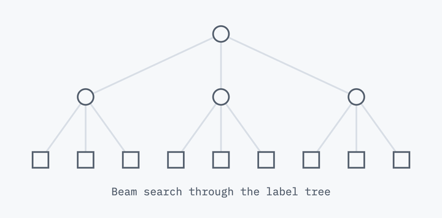
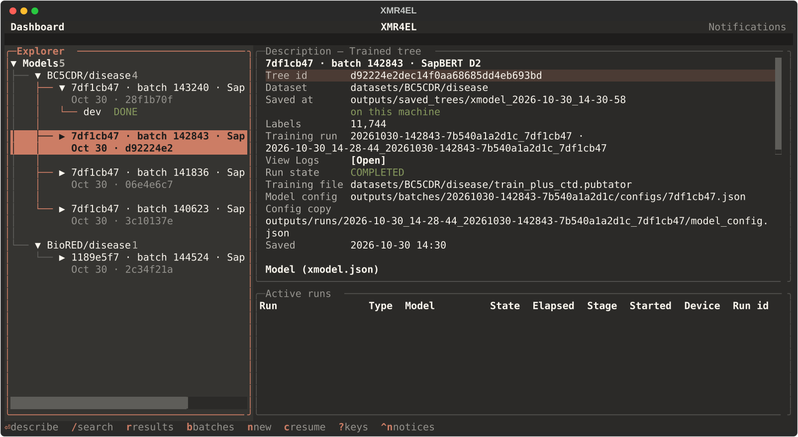
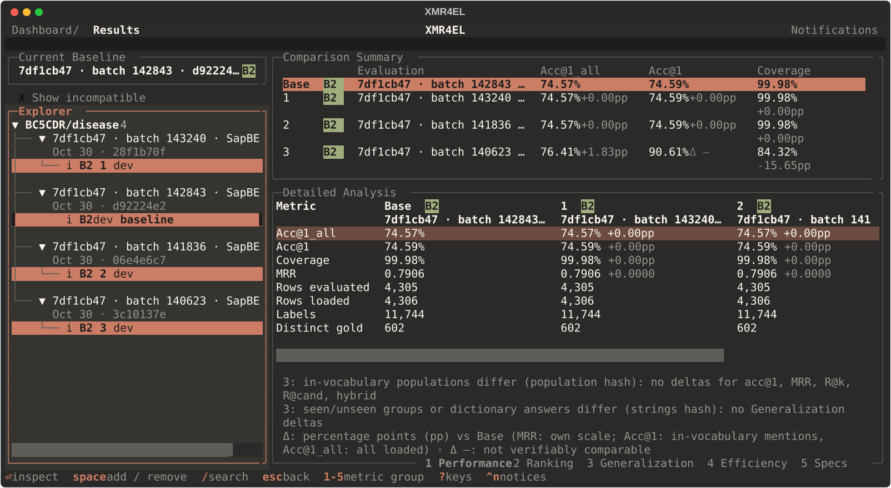

#  XMR4EL

[](https://github.com/lasigeBioTM/XMR4EL/actions/workflows/ci.yml)
[](LICENSE)
[](https://vedore.github.io/xmr4el-web/)

Extreme multi-label ranking for biomedical entity linking on local files. Training
groups texts by concept ID, encodes them, builds PIFA label embeddings, clusters
labels into a hierarchy, and trains a matcher per node. Prediction ranks labels
for supplied mentions and context by beam search, with optional mention-kNN fusion.
Mention detection, a knowledge-base lookup service, and a serving API are outside
the implemented pipeline.

<picture>
  <source media="(prefers-color-scheme: dark)" srcset="docs/images/beam-search-tree-dark.gif">
  
</picture>

| Reference | Contents |
| --- | --- |
| [Pipeline](docs/PIPELINE.md) | Data contracts, features, labels, hierarchy, scoring, evaluation and persistence. |
| [Scripts](docs/SCRIPTS.md) | Preparation, training, tracked runs, diagnostics, baselines and development checks. |
| [TUI reference](docs/TUI.md) | Terminal workflows, keys, execution, file and comparison contracts. |
| [Benchmark](docs/BENCHMARK.md) | Recorded results and provenance; verification is tracked in [INVENTORY.md](docs/INVENTORY.md). |

## Setup

Python 3.12+ is required by [pyproject.toml](pyproject.toml). From a checkout with
`uv` installed:

```bash
uv sync --locked
```

[uv.lock](uv.lock) records dependency versions. On Linux the project selects
Torch from the CUDA 12.6 index. Transformer encoding prefers CUDA, then Apple MPS,
then CPU; matcher training has additional device and sparse-input constraints
in [PIPELINE.md](docs/PIPELINE.md#training-and-inference).
The first transformer use needs a downloaded Hugging Face checkpoint or a local
checkpoint/cache. The supplied presets use SapBERT.

## Inputs and quick start

Supply local files under `datasets/` or `data/`; the examples assume they already
exist. Training is label-centric: multiple texts for one ID are positives for
that label, rather than a document-level linking target.

PubTator uses title/abstract headers and tab-separated annotations:

```text
12345|t|Aspirin and stroke
12345|a|Aspirin reduced the risk of stroke.
12345	0	7	Aspirin	Chemical	D001241
```

Annotations contain document ID, start, end, mention, type and concept ID. Offsets
refer to `title + " " + abstract` when an abstract is present. The reader creates
`mention [SEP] context`; context is the document or a configured word window.
See [reader rules](docs/PIPELINE.md#preprocessing) for skipped IDs, composites and validation.

```bash
.venv/bin/python scripts/train.py \
  -train_path datasets/ncbi_disease/train.pubtator \
  -model_config configs/xmr4el_bc5cdr_config.json
```

Copy the saved path printed by training into `MODEL`:

```bash
MODEL=outputs/saved_trees/xmodel_REPLACE_WITH_SAVED_NAME
.venv/bin/python scripts/evaluate.py \
  -xmodel_path "$MODEL" -test_path datasets/ncbi_disease/dev.pubtator \
  -train_path datasets/ncbi_disease/train.pubtator
```

`-ds_len N` on `train.py` selects the first N label groups, not a random sample or
a document limit. Small vocabularies can make the preset's clustering infeasible
and reduce evaluation coverage. [SCRIPTS.md](docs/SCRIPTS.md#train-and-evaluate) lists defaults.

Grouped TSV training instead uses `integer_group_id<TAB>text` plus a label file
aligned with sorted group IDs. It requires `-labels_path` and `"features": "tfidf"`;
see the [TSV recipe](docs/SCRIPTS.md#grouped-tsv). The evaluation CLI reads PubTator.

For Python inference, pass already formatted queries:

```python
from xmr4el.xmodel import XModel

model = XModel.load("outputs/saved_trees/xmodel_REPLACE_WITH_SAVED_NAME")
scores = model.predict(["aspirin [SEP] Aspirin reduced the risk of stroke."])
row = scores.getrow(0)
best = model.initial_labels[row.indices[row.data.argmax()]] if row.nnz else None
```

The result is a CSR matrix of queries × labels; column `j` names
`model.initial_labels[j]`. [Prediction settings](docs/PIPELINE.md#training-and-inference)
default to the saved tree's configuration.

## Evaluation and recorded runs

Evaluation reports acc@1, MRR, recall@k, candidate recall and vocabulary coverage.
Ranking metrics use loaded rows whose gold label is in the trained vocabulary;
`acc@1_all` counts other loaded rows as misses. `-train_path` adds mention-string
groups and dictionary/hybrid accuracy. Candidate recall also reflects the leaf
candidate cap and any final `topk` cut. See [metric definitions](docs/PIPELINE.md#evaluation).

```bash
.venv/bin/python scripts/run_experiment.py -spec configs/experiments/bc5cdr.json
```

The runner trains/evaluates a PubTator spec, or evaluates an existing tree with
`-xmodel_path`. It writes provenance, metrics, logs and telemetry under
`outputs/runs/`. [SCRIPTS.md](docs/SCRIPTS.md#tracked-runs) documents validation and outputs.

## Optional terminal UI

The terminal interface is built with [Textual](https://textual.textualize.io/).

```bash
uv sync --locked --extra tui
.venv/bin/python -m xmr4el_tui --root .
```

The `xmr4el-tui` entry point is equivalent. See the [TUI reference](docs/TUI.md)
for browsing results, monitoring runs and launching experiments.





*Screenshots from small test batches; the values are not benchmark results.*

## Docker

[xmr4el.dockerfile](docker/xmr4el.dockerfile) installs locked dependencies, including the
TUI and NVML extras, in `/opt/venv`. Mount the checkout at `/app`; use `python3`
inside the container. This example assumes NVIDIA Container Toolkit; omit
`--gpus all` for CPU:

```bash
docker build -f docker/xmr4el.dockerfile -t xmr4el .
mkdir -p "$HOME/.cache/huggingface"
docker run --rm --init --gpus all --user "$(id -u):$(id -g)" \
  --mount "type=bind,src=$PWD,dst=/app" \
  --mount "type=bind,src=$HOME/.cache/huggingface,dst=/cache/huggingface" \
  -e HF_HOME=/cache/huggingface \
  xmr4el python3 scripts/train.py \
  -train_path datasets/ncbi_disease/train.pubtator \
  -model_config configs/xmr4el_bc5cdr_config.json
```

## Boundaries

- Labels need training text; empty groups add no output column. Dictionary names
  can supply training rows through `dict_to_pubtator.py`.
- Features can be dense or sparse, but PIFA label embeddings and matcher weights
  are dense. Label blocking and query batching do not bound total model memory.
- Input hashes establish provenance, not independent train/dev/test documents.
  The runner rejects identical training/evaluation files during training, but
  does not check document overlap across different files.
- Checkpoint revisions are retained for Hub models. Edited local model directories
  do not invalidate the embedding cache automatically; clear it or disable it.
- Seeds and locked packages do not establish numerical identity across hardware;
  candidate pruning also has no universal label-ID tie rule.
- Load only trusted saved trees: component loading uses Python pickle and can
  execute code. Older internal layouts require retraining; no migration is provided.

## Development and layout

```bash
uv sync --locked --group dev --extra tui
.venv/bin/python -m pytest tests/ -q
uvx ruff check xmr4el xmr4el_tui scripts tests
```

[CI](.github/workflows/ci.yml) declares these checks and an installed-wheel smoke
check with a mocked transformer. [SCRIPTS.md](docs/SCRIPTS.md#development-checks) lists
targeted tests and script self-checks. These checks do not establish corpus
quality, accelerator behavior or benchmark reproduction.

| Path | Purpose |
| --- | --- |
| `xmr4el/data/` | Readers, grouping, PubTator splits and export. |
| `xmr4el/features/` | TF-IDF, SVD, frozen transformer encoding and PIFA. |
| `xmr4el/hierarchy/`, `xmr4el/learning/` | Clustering, node matchers, beam search and mention-kNN. |
| `xmr4el/xmodel.py`, `xmr4el/eval.py`, `xmr4el/rerank.py` | Public API, metrics and optional experimental reranker. |
| `xmr4el/telemetry/`, `xmr4el_tui/` | Runner events/resources and terminal application. |
| `scripts/`, `configs/`, `tests/` | Commands, JSON presets/specs and checks. |
| `outputs/` | Generated trees, runs, caches and exports (gitignored). |
| `docs/` | Pipeline, scripts, TUI and benchmark guides, verification inventory and assets. |
| `docker/` | Project, PECOS and scispaCy dependency images. |

MIT license; see [LICENSE](LICENSE).
